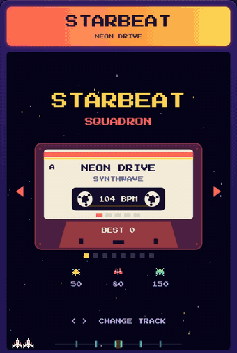
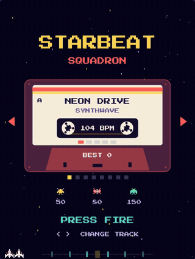
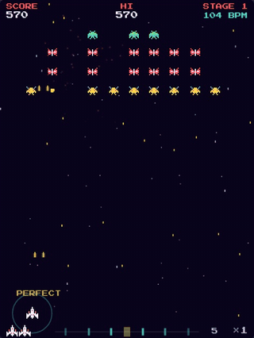
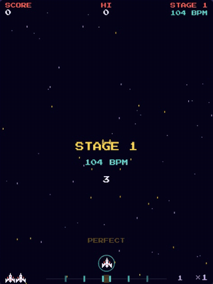
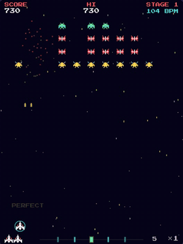
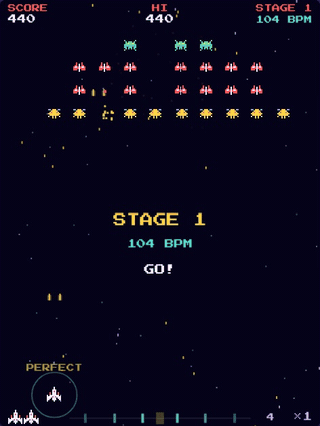

# Starbeat Squadron

A Galaga-style rhythm shooter that runs in your browser. **Your cannon only fires on the beat.** The swarm sways, dives and shoots in time with the music, and every wave you clear pushes the tempo up.

**▶ Play it: https://damonsea.github.io/starbeat-squadron/**

<p align="center"></p>

## Features

### Cassette-tape track select
Every track gets its own cassette, tinted in that track's colours. The label shows the name, style, difficulty and your best score, and the reels spin on every beat of the preview. Flip through with ← → and the next tape slides in, while the STARBEAT title pulses to the music. You can switch to a classic box in the settings.


### Tape-deck start
Press fire and the cassette drops into a STARBEAT deck, the door clunks shut, PLAY lights up and the reels roll into stage 1.

<p align="center"></p>

### Shoot on the beat
A Perfect shot (within 55 ms of the beat) fires twin piercing shots, a Great shot (within 110 ms) fires one, and a Miss jams the cannon and resets your combo. Every 8 on-beat shots raises your multiplier, up to ×8. The swarm sways, dives and fires in time with the music, and each cleared wave adds 8 BPM.

<p align="center"></p>

### Skull bosses
Every third stage brings in a skull boss: the Skull Ship, Skull King, Demon Skull and Ghost Skull, in that order. Its jaw snaps to the beat. When the red outline flashes under it, move. If the tractor beam catches you, land 4 Perfect shots in a row to break free and stun it.

<p align="center"></p>

### Screen filters
CRT, Game Boy, Monochrome and VHS. Press F to cycle through them, even in the middle of a run.

<p align="center"></p>

### Cassette pause
Pausing brings up the deck with the pause key held down and the reels frozen. From there you can resume or go back to the menu.

<p align="center"></p>

### And also
- **8 tracks.** Four are generated live by the game: Neon Drive (synthwave), Mothership Strut (funk), Pixel Overture (chiptune) and Liquid Velocity (drum & bass). The other four are recordings: Moon Colony, Red Sky, Primate Pulse and Swarm Song. On those, the tempo stays fixed and you win by surviving to the end of the song. Red Sky follows a note chart instead of a fixed beat: 527 notes placed on the song's actual accented hits, Guitar Hero style.
- **PS5 and standard controller support**, with rumble.
- **A separate high score for each track**, plus your settings, saved in your browser.

## Controls

| | Keyboard | Controller |
|---|---|---|
| Fly | ← → or A / D | Left stick or d-pad |
| Fire (on the beat) | Space or J | ✕, □, R1 or R2 |
| Pause | P or Esc | Options (○ to resume) |
| Change track (menu) | ← → | Stick or d-pad |
| Cycle screen filter | F | |

If your shots keep grading late (common with Bluetooth headphones), raise the timing offset in the settings panel.

## Running it locally

The four built-in tracks work if you just open `index.html`. The recorded tracks load from mp3 files, and browsers block that for pages opened straight from your disk, so serve the folder instead:

```
python3 -m http.server
```

Then open http://localhost:8000.

## Files

- `index.html`: the whole game in one file (no build step, no dependencies)
- `*.mp3`: the four recorded tracks
- `media/`: the GIFs in this README
- `original-version/`: the first prototype, with one synthwave track
